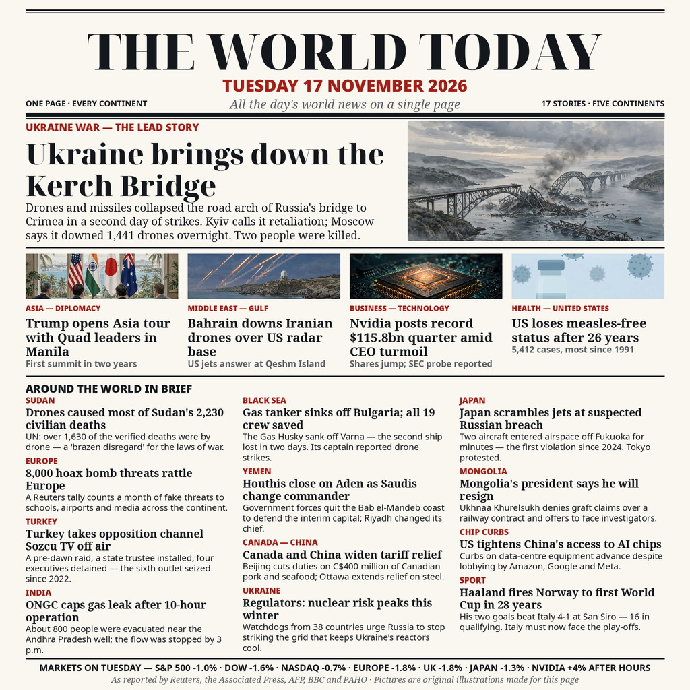

# THE WORLD TODAY — Tuesday 17 November 2026

Entry for the make.fun bounty **news-image-20261117** ("Sum up 17 November's
world news in one image") — bounty page: https://make.fun/bounty/news-image-20261117.

One front page, 17 stories: Ukraine's destruction of the Kerch Bridge as the
lead, the Quad summit in Manila, Bahrain's interception of Iranian drones,
Nvidia's record quarter, the US losing measles-elimination status, a sunken
gas tanker in the Black Sea, and twelve world briefs — plus the day's market
moves in the footer.

## How it was made

- Every story was reported on Tuesday 17 November 2026 and is confirmed by at
  least two independent credible outlets (Reuters, AP, AFP, BBC, PAHO and
  peers). The full sourcing, with the exact facts and figures used on the
  page, is in [SOURCES.md](SOURCES.md).
- The six pictures are original illustrations generated for this page and
  contain no text. All headlines, labels and the masthead were typeset
  programmatically (PIL) at 2048×2048 and downscaled with a Lanczos resample
  to the final 1024×1024, then proofread letter by letter at full zoom.
- `main.py` (Python 3, standard library only) copies the finished image to
  `$MAKEFUN_OUTPUT_DIR/entry.png` (or `/output/entry.png`). It is
  deterministic: repeated runs produce byte-identical output.

## Files

- `entry.png` — the finished image (JPEG-encoded, 1024×1024, under the
  1 MiB limit; the rules accept PNG or JPEG by magic bytes).
- `main.py` — the entry program.
- `SOURCES.md` — story-by-story sourcing and fact sheet.
